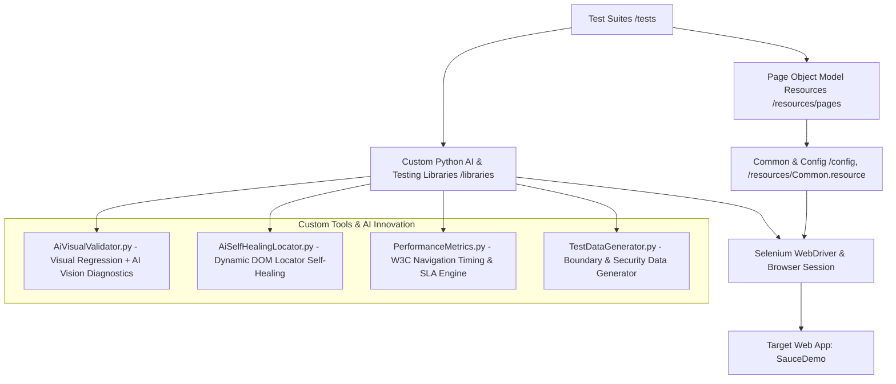

# Enterprise SDET Automation Framework (Robot Framework + Python + Selenium + AI)

[](https://github.com/example/robotframework-selenium-sdet/actions)
[](https://robotframework.org/)
[](https://www.selenium.dev/)
[](https://www.python.org/)
[](LICENSE)

An enterprise-grade, scalable test automation framework engineered for high reliability, maintainability, and innovation. Built for the **SDET Technical Exercise**, this repository features a modular **Page Object Model (POM)**, end-to-end web testing of [SauceDemo](https://www.saucedemo.com/), and **four custom Python libraries** showcasing cutting-edge capabilities in **AI Visual Regression**, **Self-Healing Dynamic Locators**, **W3C Performance SLA Benchmarking**, and **Dynamic Boundary Test Data Generation**.

---

## 🌟 Architecture & Highlights



### Key Design Tenets
1. **Separation of Concerns**: Test suites contain high-level business logic and declarative assertions; page resource files encapsulate locators and DOM actions; custom Python libraries provide reusable tools and AI innovations.
2. **Resilience & Self-Healing**: Tests gracefully heal broken or modified locators at runtime without pipeline disruption.
3. **AI-Driven Visual Diagnostics**: Visual discrepancies are automatically highlighted with pixel diff heatmaps and classified by an AI anomaly engine.
4. **Performance Engineering**: Real-time browser performance telemetry (TTFB, DOM Interactive, Page Load) integrated into test execution.

---

## 🛠️ Custom Tools & Innovations Addressing Testing Gaps

| Innovation | Tool / Library | Problem Addressed | SDET Technical Solution |
| :--- | :--- | :--- | :--- |
| **AI Visual Regression** | [`AiVisualValidator.py`](file:///c:/Users/acatt/Desktop/robotframework-selenium-sdet/libraries/AiVisualValidator.py) | Traditional assertion tests miss layout shifts, missing images, and CSS distortions. | Computes perceptual pixel deltas, bounding box heatmaps, and triggers an **AI Vision Diagnostic engine** (supports Gemini/OpenAI Vision or offline Computer Vision Heuristic) that classifies regressions directly inside `log.html`. |
| **Self-Healing Locators** | [`AiSelfHealingLocator.py`](file:///c:/Users/acatt/Desktop/robotframework-selenium-sdet/libraries/AiSelfHealingLocator.py) | Brittle selectors break CI/CD pipelines during UI updates. | When selectors fail, dynamically inspects the live DOM, calculates token recall and fuzzy similarity scores across `data-test`, `id`, `name`, `aria-label`, and text, highlights the repaired element, logs confidence percentage, and continues execution. |
| **W3C Web Vitals SLAs** | [`PerformanceMetrics.py`](file:///c:/Users/acatt/Desktop/robotframework-selenium-sdet/libraries/PerformanceMetrics.py) | Functional tests do not catch performance regressions or server latency. | Extracts high-precision browser Navigation Timing API v2 metrics (TTFB, DOM Interactive, Total Load Time, Payload Size) and validates performance budgets against target SLAs. |
| **Data Generation & Security** | [`TestDataGenerator.py`](file:///c:/Users/acatt/Desktop/robotframework-selenium-sdet/libraries/TestDataGenerator.py) | Hardcoded static data limits test variation and fails to uncover edge cases. | Generates randomized personas, boundary overflow strings, and sanitization attack vectors (XSS, SQLi payloads) to verify form resilience. |

---

## 📂 Project Structure

```
robotframework-selenium-sdet/
├── .github/
│   └── workflows/
│       └── ci.yml                     # GitHub Actions CI/CD pipeline
├── baselines/                         # Visual baseline reference screenshots
├── config/
│   ├── env_config.resource            # Global URLs, credentials, timeouts, dimensions
│   └── settings.py                    # Environment variable overrides
├── libraries/                         # Custom Python SDET Extensions
│   ├── AiVisualValidator.py           # Visual diff engine & AI anomaly detector
│   ├── AiSelfHealingLocator.py        # Dynamic selector recovery engine
│   ├── PerformanceMetrics.py          # Browser W3C Navigation Timing API
│   └── TestDataGenerator.py           # Synthetic personas & security payloads
├── resources/
│   ├── Common.resource                # Browser lifecycle, options & teardowns
│   └── pages/                         # Page Object Model (POM)
│       ├── LoginPage.resource         # Authentication page elements & actions
│       ├── InventoryPage.resource     # Product catalog, sorting, and cart actions
│       ├── CartPage.resource          # Cart review actions & assertions
│       └── CheckoutPage.resource      # Multi-step checkout & financial math
├── testdata/
│   ├── users.json                     # Persona datasets (standard, locked, glitch, visual)
│   └── checkout_data.json             # Product pricing & boundary matrices
├── tests/                             # Robot Framework Test Suites
│   ├── 01_authentication.robot        # Positive, negative, locked user, session security
│   ├── 02_inventory_and_cart.robot    # Sorting (Price/Name), badge counter, persistence
│   ├── 03_checkout_e2e.robot          # End-to-end purchase, 8% tax calculation, XSS defense
│   ├── 04_ai_visual_regression.robot  # Baseline creation & AI anomaly diagnostics
│   ├── 05_self_healing_locators.robot # Resilience against broken / deprecated selectors
│   └── 06_performance_benchmarks.robot# Page load SLA assertions & latency profiling
├── reports/                           # Output HTML reports, logs, and screenshots
├── requirements.txt                   # Project Python dependencies
├── run_tests.py                       # CLI Test Runner with tags and browser switches
├── run_tests.bat                      # Windows one-click execution script
├── run_tests.sh                       # Linux / macOS execution script
└── README.md                          # Framework documentation
```

---

## 🧪 Test Suites & Coverage Matrix

| Suite | Focus Areas | Key Test Scenarios | Tags |
| :--- | :--- | :--- | :--- |
| **`01_authentication.robot`** | Authentication & Security | • Happy path login (`standard_user`)<br>• Locked user error handling (`locked_out_user`)<br>• Invalid credentials rejection<br>• Missing username & password validation<br>• Secure session logout and cache purge | `smoke`, `auth`, `negative`, `security` |
| **`02_inventory_and_cart.robot`** | Catalog & Shopping Cart | • Price sorting ascending (low-to-high)<br>• Price sorting descending (high-to-low)<br>• Alphabetical title sorting (A-Z)<br>• Dynamic cart badge incrementation & decrement<br>• Cart state persistence across page refresh | `inventory`, `sorting`, `cart`, `persistence` |
| **`03_checkout_e2e.robot`** | End-to-End & Boundary | • Multi-step purchase flow with dynamic persona<br>• Mathematical validation of item subtotal + 8% tax = total<br>• Boundary testing on mandatory fields (First/Last/Postal)<br>• Security script injection resilience | `e2e`, `checkout`, `boundary`, `security` |
| **`04_ai_visual_regression.robot`** | AI Visual Testing | • Visual baseline establishment<br>• AI Anomaly detection on `visual_user` UI regressions<br>• Layout drift identification & diff heatmap logging | `visual`, `ai`, `anomaly_detection` |
| **`05_self_healing_locators.robot`** | Automation Resilience | • Automatic recovery from obsolete input IDs<br>• Heuristic resolution of modified button classes<br>• Full multi-element authentication with broken selectors | `self_healing`, `resilience`, `ai` |
| **`06_performance_benchmarks.robot`** | Performance Engineering | • Landing page load SLA budget assertion (< 3.0s)<br>• Catalog network responsiveness (TTFB SLA < 3.0s)<br>• Latency degradation profiling on `performance_glitch_user` | `performance`, `sla`, `benchmark` |

---

## 🚀 Setup & Execution Guide

### Prerequisites
- **Python**: 3.10+ (Tested on Python 3.12)
- **Google Chrome** / Chromium (ChromeDriver is automatically managed by Selenium 4 Selenium Manager)
- **Git**

### Installation

1. Clone repository:
   ```bash
   git clone https://github.com/example/robotframework-selenium-sdet.git
   cd robotframework-selenium-sdet
   ```

2. Create virtual environment (optional but recommended):
   ```bash
   python -m venv .venv
   # Windows:
   .venv\Scripts\activate
   # Linux/macOS:
   source .venv/bin/activate
   ```

3. Install required packages:
   ```bash
   pip install -r requirements.txt
   ```

---

### Running Tests

Execute all tests or filter by suites and tags using the custom test runner [`run_tests.py`](file:///c:/Users/acatt/Desktop/robotframework-selenium-sdet/run_tests.py):

#### 1. Execute All Tests (Default Headless Chrome)
```bash
python run_tests.py
```

#### 2. Execute by Tag Expression
```bash
# Run Smoke tests
python run_tests.py -t smoke

# Run AI Visual Regression tests
python run_tests.py -t visual

# Run Self-Healing Locator tests
python run_tests.py -t self_healing

# Run End-To-End Checkout flow
python run_tests.py -t e2e
```

#### 3. Execute a Specific Test Suite
```bash
python run_tests.py -s 01_authentication
python run_tests.py -s 03_checkout_e2e
python run_tests.py -s 05_self_healing_locators
```

#### 4. Run in Headed Browser (Visible GUI)
```bash
python run_tests.py -b chrome -s 01_authentication
```

#### 5. Windows / Linux Convenience Scripts
- **Windows**: Double-click or run `run_tests.bat`
- **Linux / macOS**: Run `./run_tests.sh`

---

## 📊 Rich Test Reports & AI Diagnostics

After execution, self-contained reports and interactive logs are generated in the `reports/` folder:
- **`reports/report.html`**: Executive dashboard with pass/fail metrics, execution time breakdown, and tag statistics.
- **`reports/log.html`**: Deep diagnostic log featuring:
  - **Embedded Base64 Visual Diff Cards**: Side-by-side Baseline, Current, and Difference Heatmap.
  - **Self-Healing Event Cards**: Original broken locator, repaired locator, and confidence percentage.
  - **Performance Telemetry Badges**: TTFB, DOM Interactive, and Total Load Time breakdown.

---

## 🔄 CI/CD Pipeline (GitHub Actions)

A fully automated CI/CD pipeline is configured in [`.github/workflows/ci.yml`](file:///c:/Users/acatt/Desktop/robotframework-selenium-sdet/.github/workflows/ci.yml).
- Automatically triggers on every `push` and `pull_request` to `main` / `master`.
- Sets up Python 3.12, caches dependencies, installs Google Chrome headless.
- Executes the complete test suite.
- Publishes Robot Framework HTML test reports and visual baseline artifacts with a 14-day retention.

---

## 🏆 Evaluation Criteria Alignment

- **Code Quality**: Strict separation of concerns adhering to the Page Object Model (POM), standard Robot Framework coding guidelines, docstrings, type annotations, and clean Python code.
- **Creativity & Innovation**:
  - Custom AI Visual Validator with perceptual diffing and natural language diagnostics.
  - Custom DOM Self-Healing engine that rescues tests from locator degradation.
  - Real-time W3C Navigation Timing API performance profiling.
- **Scalability & Structure**: Reusable resource components, centralized environment configuration, dynamic test data generation, and enterprise CI/CD integration.
